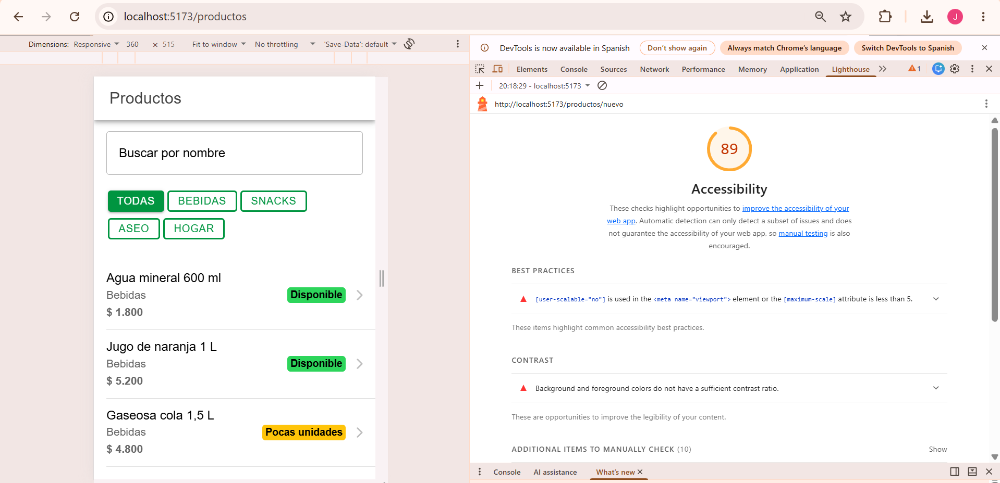
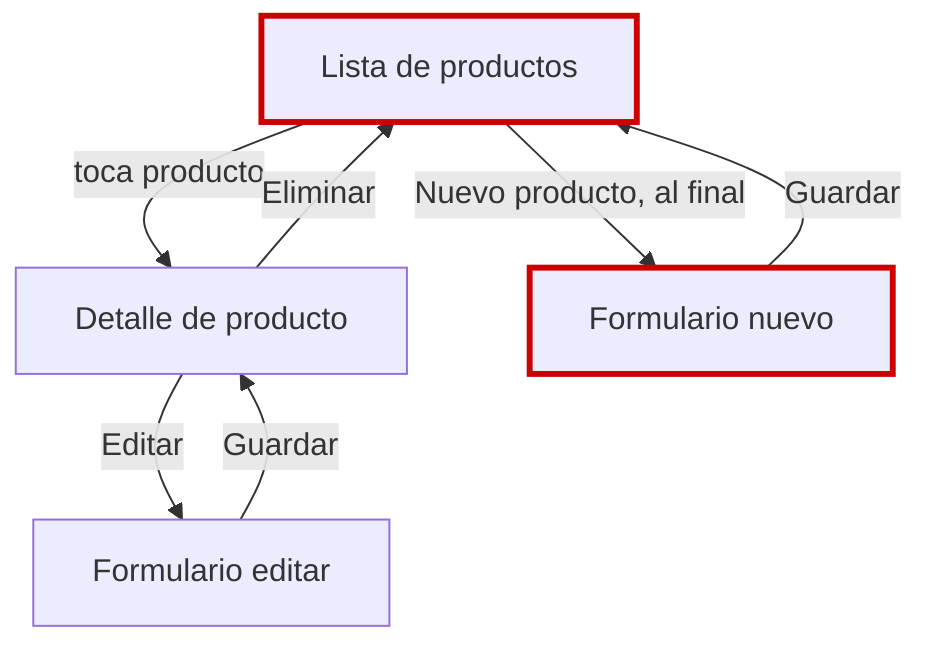

# CP1 · Auditoría UX

Pantallas: Lista de productos (`/productos`), Detalle de producto (`/productos/:id`), Formulario de producto (`/productos/nuevo` y `/productos/:id/editar`). Capturas tomadas a 360 px de ancho.

| Lista | Detalle | Formulario |
|---|---|---|
|  |  |  |

Lighthouse Accesibilidad (antes, Mobile): Lista 91 · Formulario 89

## Hallazgos

| Pantalla | Problema | Principio | Severidad | Arreglo propuesto |
|---|---|---|---|---|
| Lista de productos | Mientras carga solo muestra el texto "Cargando productos…" | Estados de la interfaz | Alta | IonSkeletonText con la forma de ProductCard |
| Lista de productos | El botón "Nuevo producto" queda al final de la lista; a 360 px no se ve sin bajar | Jerarquía visual | Media | IonFab fijo abajo a la derecha |
| Lista de productos | Botones de categoría (Todas, Bebidas, Snacks, Aseo, Hogar) de unos 27 px de alto | Área táctil mínima 44 px | Media | Botones de 44 px de alto |
| Lista de productos | No se puede recargar deslizando si la API falló o cambió el stock | Retroalimentación | Media | IonRefresher |
| Lista de productos | En pantalla ancha la lista se estira de borde a borde y el badge queda lejos del nombre | Comportamiento responsivo | Media | Contenedor con ancho máximo |
| Detalle de producto | Mientras carga solo muestra "Cargando producto…" | Estados de la interfaz | Alta | Skeleton con la forma de los campos |
| Detalle de producto | Muestra "Id 1", un dato técnico sin valor para el usuario, y repite el nombre | Jerarquía visual | Baja | Quitar Id y destacar precio y stock |
| Detalle de producto | Al eliminar vuelve a la lista sin confirmar que se eliminó | Retroalimentación | Alta | IonAlert de confirmación e IonToast de éxito |
| Formulario de producto | Al guardar redirige sin mensaje de éxito | Retroalimentación | Alta | IonToast "Producto guardado" |
| Formulario de producto | No indica qué campos son obligatorios ni el formato de precio y stock | Textos y etiquetas | Media | Marcar obligatorios y texto de ayuda debajo del campo |
| Toda la app | El viewport tiene user-scalable=no: no se puede hacer zoom (index.html, Lighthouse) | Accesibilidad: texto que crece | Alta | Quitar user-scalable=no y maximum-scale |
| Toda la app | Verde primario #009540 con texto blanco o sobre blanco: contraste 3.9:1 (Lighthouse) | Contraste mínimo 4.5:1 | Alta | Oscurecer el token primario |
| Toda la app | El tema solo define el color primario: no hay tokens de error, éxito, tipografía ni espacios | Consistencia | Media | Tokens en variables.css |

## Mapa de navegación actual

Dónde se pierde el usuario (en rojo): en la Lista no encuentra "Nuevo producto" sin bajar hasta el final, y después de Guardar o Eliminar no sabe si la acción funcionó.