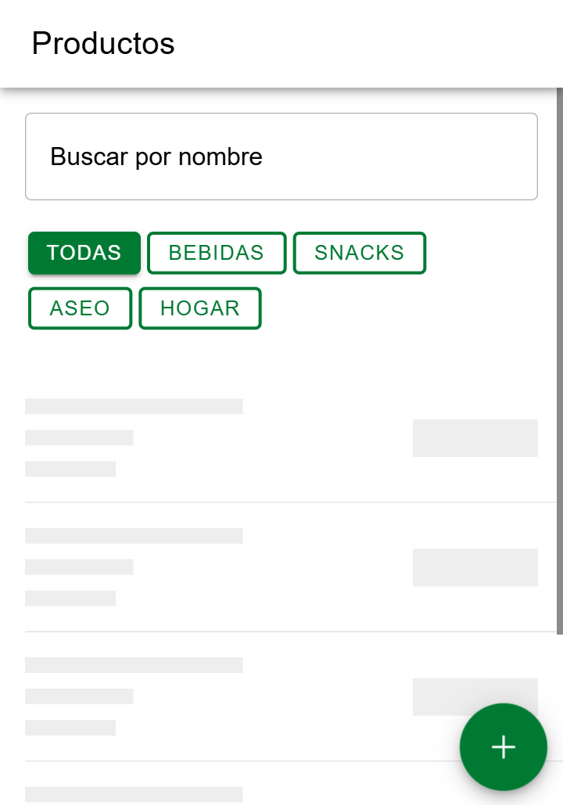
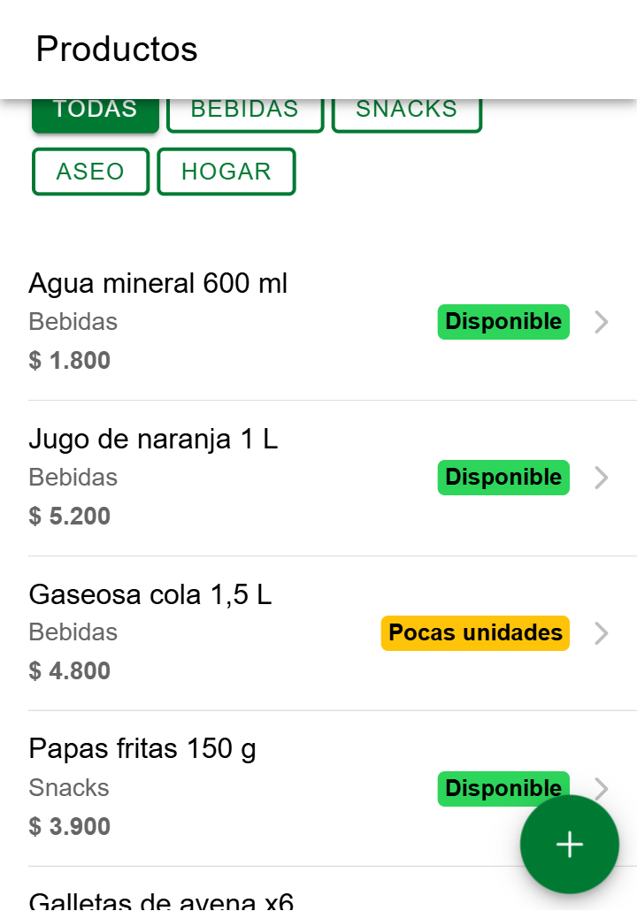
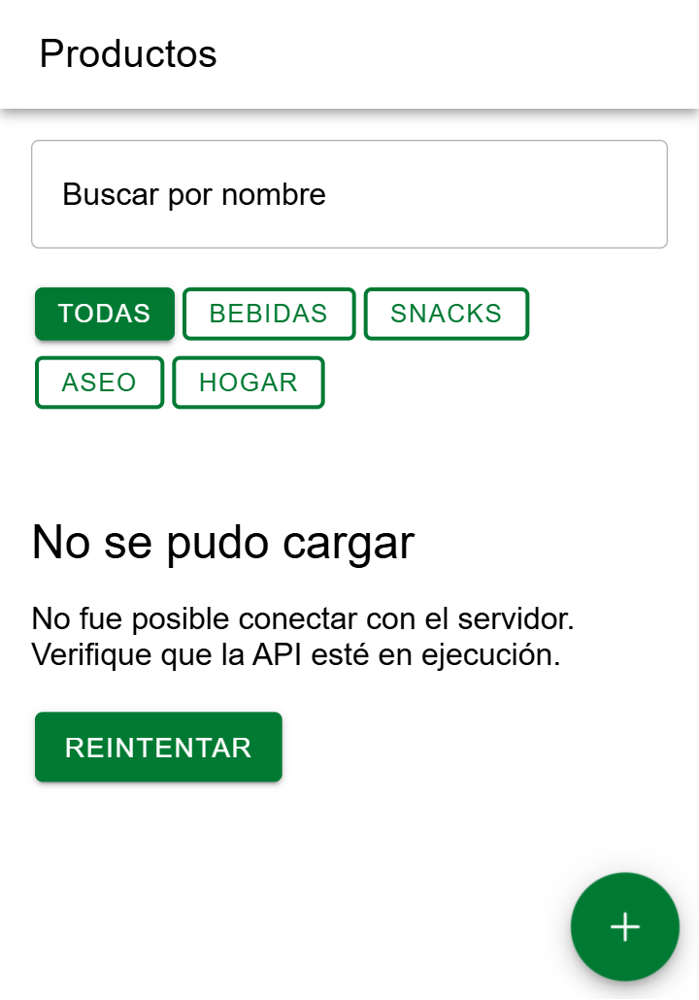
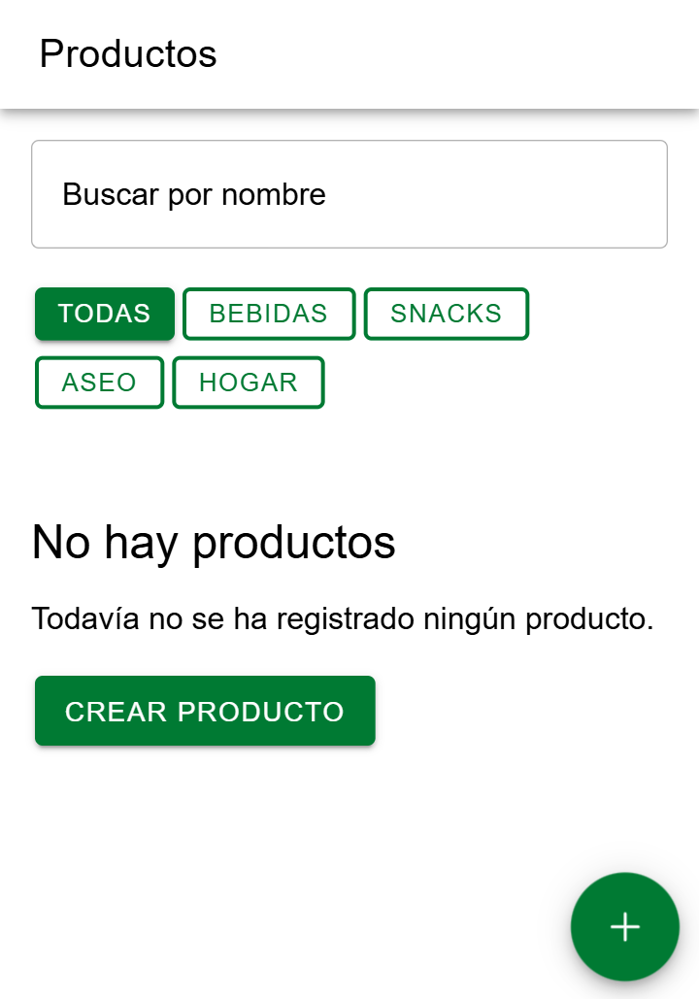

# CP3 · La pantalla de lista con sus tres estados

Pantalla: Lista de productos (`/productos`, `ProductListPage.tsx`). Entidad: Product. Endpoint: `GET /api/products`.

| Cargando | Con datos | Error | Vacío |
|---|---|---|---|
|  |  |  |  |

## Qué muestra cada estado

| Estado | Qué ve el usuario | Componente |
|---|---|---|
| Cargando | 5 filas con la forma real de ProductCard: nombre, categoría, precio y badge de stock | `ProductListSkeleton` (IonSkeletonText, `aria-busy="true"`) |
| Con datos | La lista de productos con su badge Disponible / Pocas unidades / Agotado | `ProductCard` |
| Error | "No se pudo cargar", el mensaje del error y el botón Reintentar, que vuelve a llamar a `loadProducts` | `EmptyState` |
| Vacío | "No hay productos" y el botón Crear producto, que lleva a `/productos/nuevo` | `EmptyState` |

## Cómo se fuerza cada estado

El servicio `getProducts` (`products-api.ts`) lee tres variables de `app/.env`. Ese archivo es local y no se sube, por el `.gitignore`. Después de cambiarlas hay que reiniciar `npm run dev`.

| Estado | Variables en `app/.env` |
|---|---|
| Cargando | `VITE_SIMULATED_DELAY_MS=10000` |
| Error | `VITE_SIMULATE_ERROR=true` |
| Vacío | `VITE_SIMULATE_EMPTY=true` |
| Con datos | las tres en `0` / `false`, o sin definir |

Otra forma de ver el error real: detener la API (`npm run server`) y recargar la lista.

## Recargar deslizando (IonRefresher)

Al arrastrar la lista hacia abajo aparece "Deslice para recargar" y se vuelve a llamar a `loadProducts`. Sirve cuando la API falló o el stock cambió, sin salir de la pantalla.

## Prueba automatizada

Archivo: `app/src/features/products/__tests__/ProductListPage.test.tsx` (Vitest + Testing Library).

| Prueba | Qué verifica |
|---|---|
| muestra el mensaje de error cuando la API falla | Si `getProducts` falla, aparece "No se pudo cargar" con el mensaje de conexión |
| el botón Reintentar vuelve a pedir los productos y muestra la lista | La primera llamada falla, al tocar Reintentar la segunda devuelve "Agua mineral 600 ml" y `getProducts` se llamó 2 veces |

`getProducts` se reemplaza con `vi.mock` para no depender de la API real. Resultado de `npm test`: 3 archivos, 19 pruebas pasan.