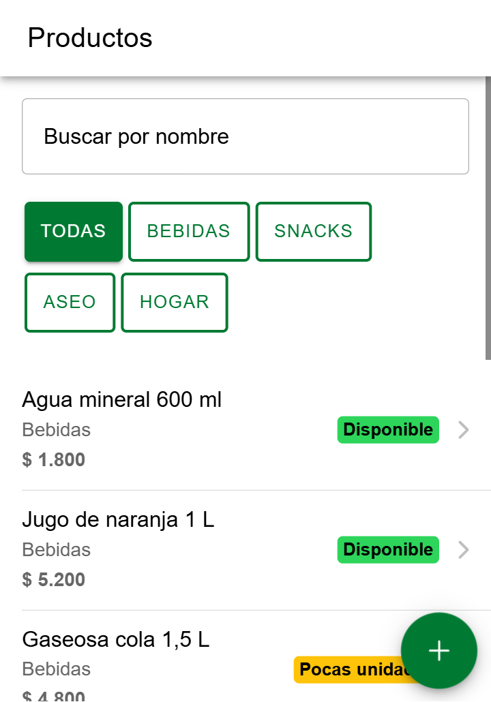
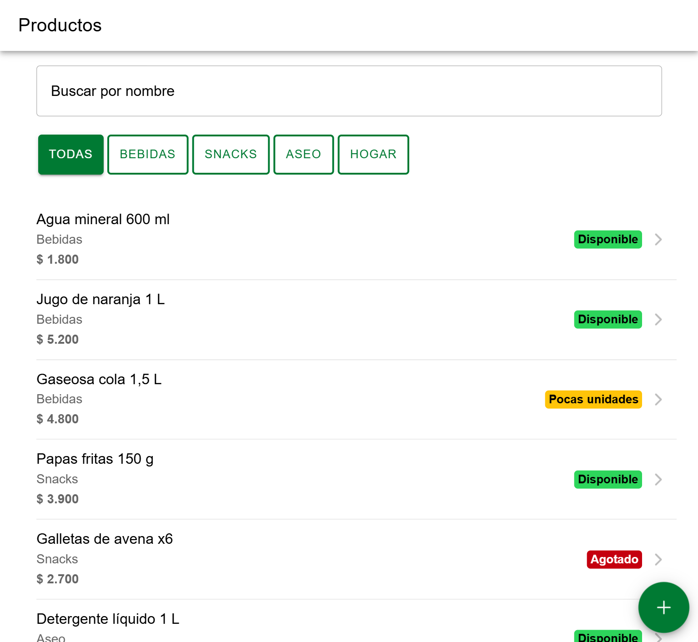

# CP4 · Accesibilidad y diseño responsivo

## Lighthouse · Accesibilidad (Mobile, /productos)

| Antes | Después |
|---|---|
| 91 | 100 |
|  |  |

## Lo corregido

| Problema | Dónde | Corrección |
|---|---|---|
| El viewport tenía `user-scalable=no` y `maximum-scale=1.0`: no se podía hacer zoom | `index.html` | Viewport solo con `width=device-width, initial-scale=1.0` |
| Contraste del verde primario 3.9:1 | `variables.css` | Token primario #007a33 (5.5:1), hecho en el CP2 y confirmado aquí por Lighthouse |
| Botones de categoría de unos 27 px de alto | Lista y Formulario | Clase `touch-target` con 44 px de alto |
| La categoría seleccionada solo se distinguía por el color | Lista y Formulario | `aria-pressed` en cada botón: el lector de pantalla dice cuál está activa |
| El botón + tapaba el badge del último producto | Lista | Espacio de 88 px al final (`list-end-space`) |
| En tableta la lista se estiraba de borde a borde | Lista | Contenedor `page-container` con ancho máximo de 720 px, centrado |
| El botón + era solo un ícono | Lista | `aria-label="Nuevo producto"` (CP2) |

Los textos usan los tamaños de Ionic, que se basan en la letra del sistema y crecen con ella. Los tokens nuevos de tamaño están en `rem`.

## Pantallas a 360 px y 768 px

| 360 px | 768 px |
|---|---|
|  |  |