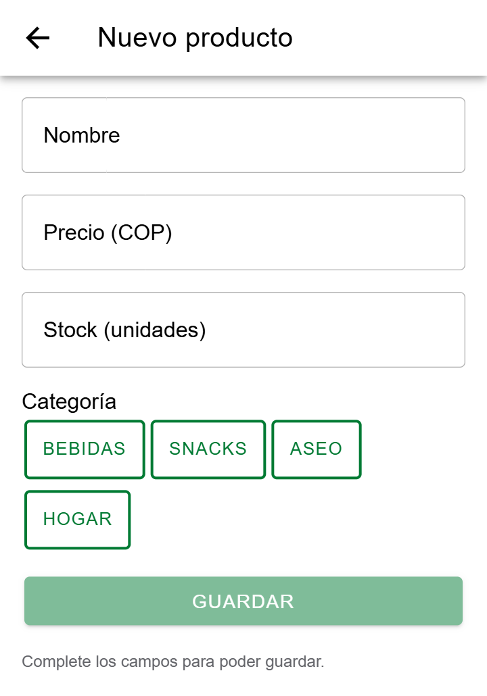
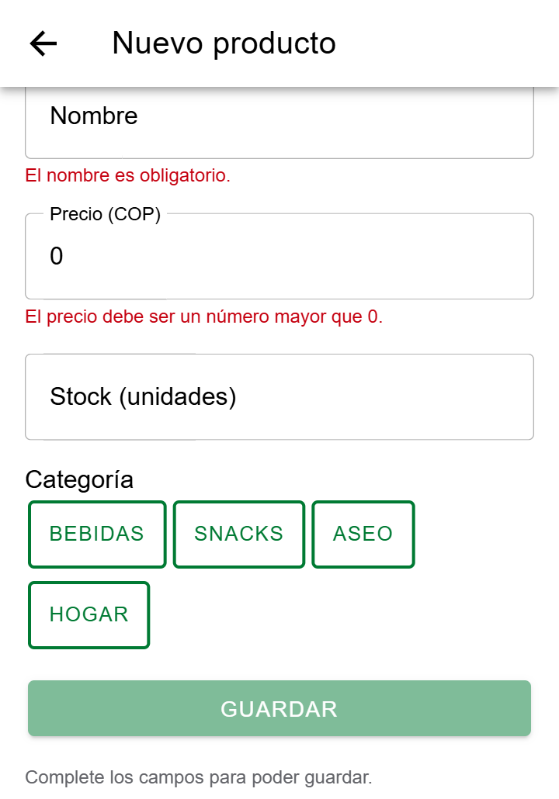
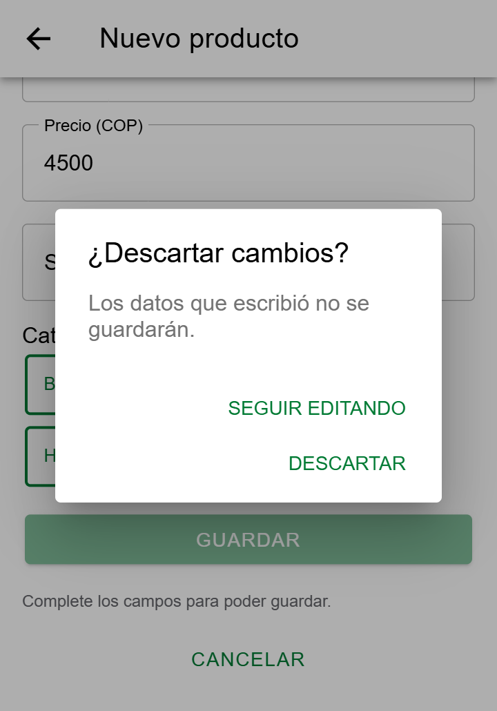
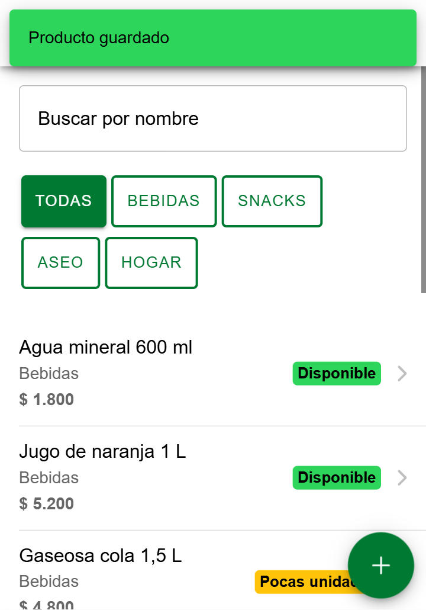
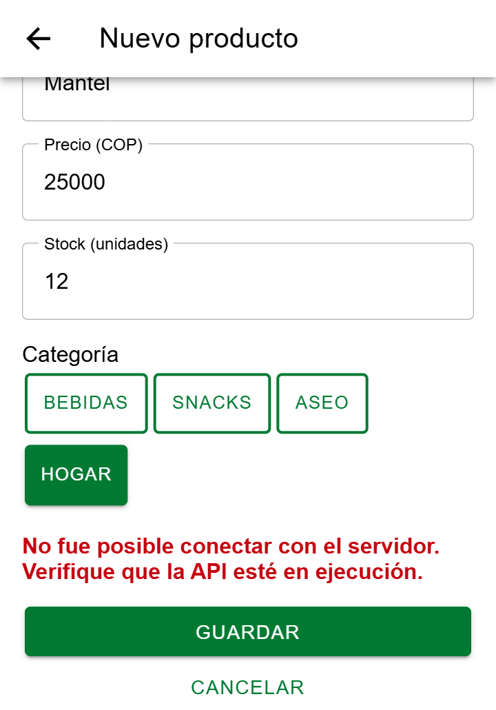

# CP6 · Formulario con validación y retroalimentación

Formulario: crear y editar Producto (`/productos/nuevo` y `/productos/:id/editar`, `ProductFormPage.tsx`). Endpoints: `POST /api/products` y `PUT /api/products/:id`.

## Reglas de validación por campo

Las reglas están en `validateProduct` (`domain/product.ts`) y son las mismas que valida la API (`server/app.js`), así el usuario ve el error antes de enviar.

| Campo | Regla | Mensaje | Por qué existe en el catálogo |
|---|---|---|---|
| Nombre | Obligatorio, máximo 60 caracteres | "El nombre es obligatorio." | Es lo que el usuario busca y lee en la lista; un nombre vacío deja una fila sin identificar y uno muy largo rompe la fila en un celular de 360 px |
| Precio (COP) | Número mayor que 0 | "El precio debe ser un número mayor que 0." | Un producto a $0 o con precio negativo es un error de digitación y daría un precio falso en el catálogo |
| Stock | Número entero mayor o igual que 0 | "El stock debe ser un número entero mayor o igual que 0." | Se cuentan unidades enteras; 0 es válido porque significa "Agotado", pero no puede haber unidades negativas |
| Categoría | Obligatoria, una de Bebidas, Snacks, Aseo u Hogar | "La categoría es obligatoria." | Los filtros de la lista funcionan por categoría; un producto sin ella no aparecería al filtrar |

## Retroalimentación al usuario

| Situación | Qué ve el usuario |
|---|---|
| Campo inválido | Mensaje en rojo justo debajo del campo, apenas lo toca |
| Hay errores | Botón Guardar deshabilitado y el aviso "Complete los campos para poder guardar" |
| Enviando | Spinner dentro del botón y el texto "Guardando…" |
| Guardado | Vuelve a la lista y aparece el IonToast "Producto guardado" |
| La API falla | Mensaje de error en rojo encima del botón Guardar |
| Cancelar con datos escritos | IonAlert "¿Descartar cambios?" con "Seguir editando" o "Descartar" |

## Capturas

| Vacío | Errores en los campos | Cancelar |
|---|---|---|
|  |  |  |

| Guardado (toast) | Error del servidor |
|---|---|
|  |  |

El error del servidor se forzó deteniendo la API (`npm run server`) antes de guardar.