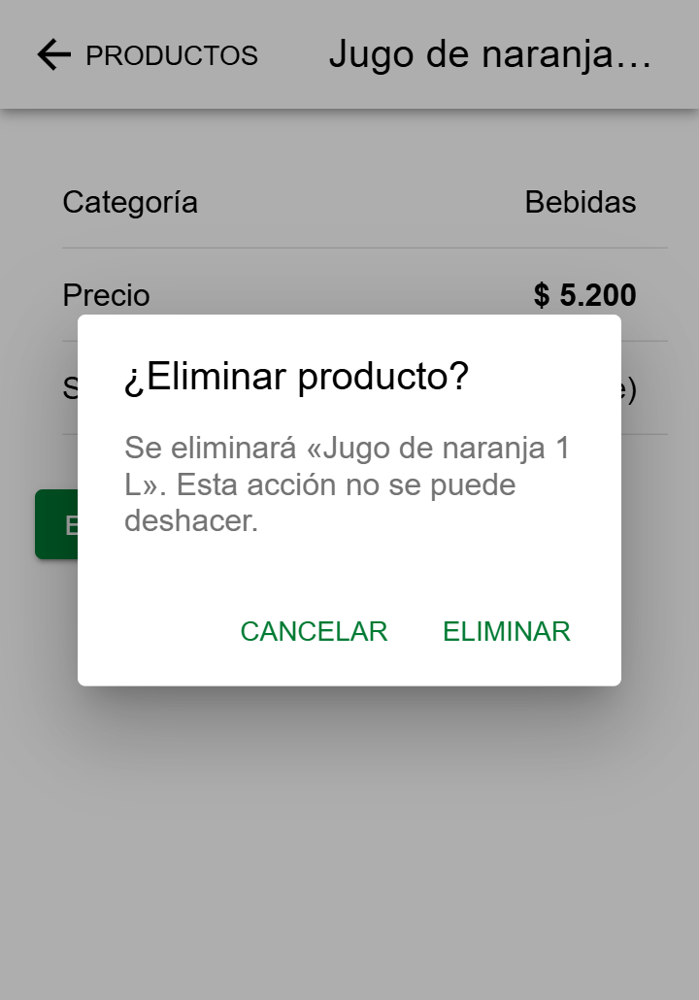
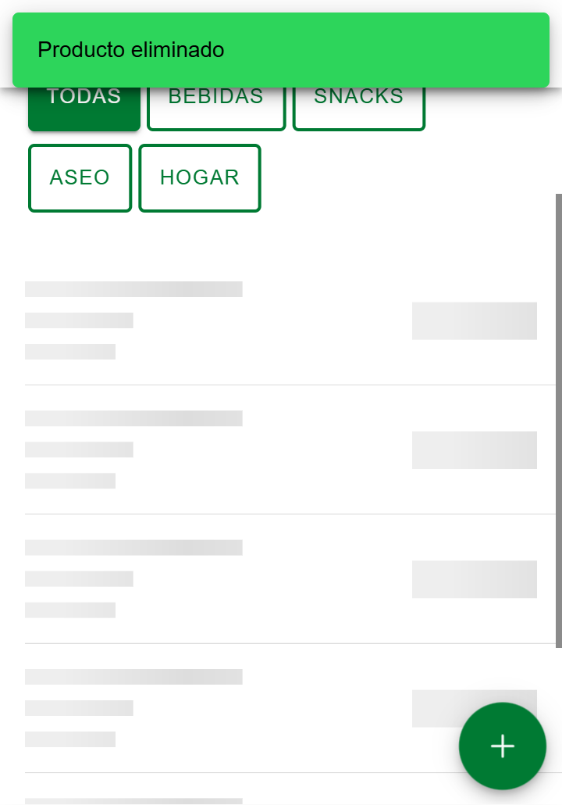
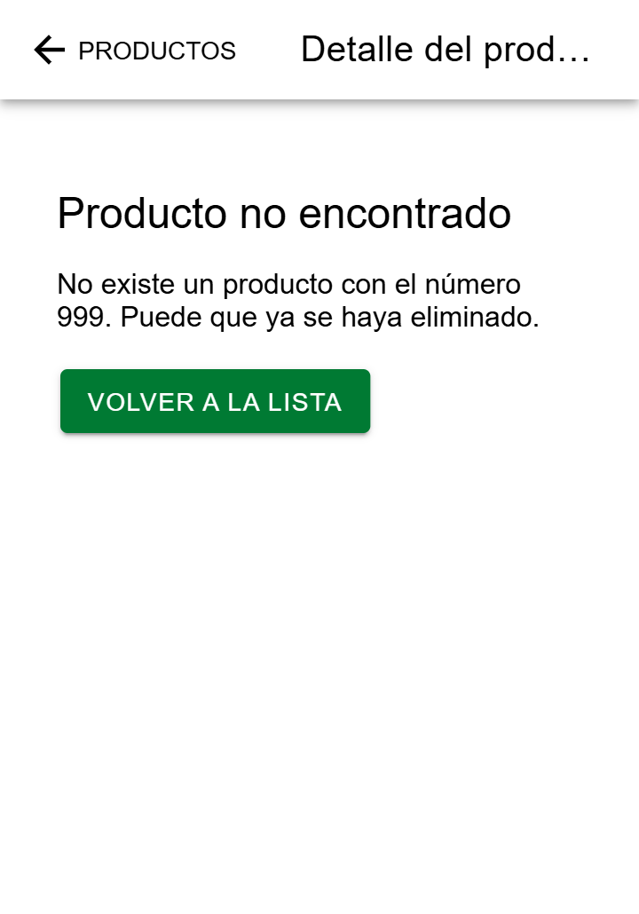
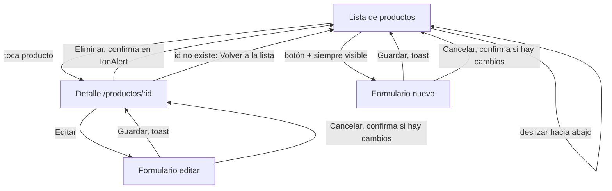

# CP7 · Detalle, parámetros de navegación y flujo completo

## Pantalla de detalle (`/productos/:id`)

El identificador llega por la ruta: `useParams` lee el `:id` como texto, se convierte con `Number` y se pide con `getProduct(id)` a `GET /api/products/:id`. La ruta acepta solo dígitos (`:id(\d+)` en `App.tsx`) para no confundirse con `/productos/nuevo`.

| Estado | Qué ve el usuario |
|---|---|
| Cargando | Skeleton con Categoría, Precio y Stock |
| Con datos | Categoría, precio en negrita y stock con su etiqueta; botones Editar y Eliminar |
| Error | "No se pudo cargar" y el botón Reintentar |
| No encontrado (404) | "Producto no encontrado", el número que no existe y el botón Volver a la lista |

Regreso: IonBackButton con el texto "Productos". Eliminar pide confirmación con IonAlert y confirma con IonToast "Producto eliminado".

| Detalle | Confirmar eliminar | Eliminado | No encontrado |
|---|---|---|---|
|  |  |  |  |

## Mapa de navegación nuevo

## Comparación con el mapa del CP1

| Tarea | Antes (CP1) | Ahora | Qué se ahorró |
|---|---|---|---|
| Crear producto | Bajar hasta el final de la lista para encontrar "Nuevo producto" | Botón + fijo, visible sin bajar | El desplazamiento hasta el final |
| Saber si se guardó | Volvía a la lista sin aviso y había que buscar el producto | Toast "Producto guardado" | Buscar el producto para comprobar |
| Eliminar | Confirmación dentro de la página y sin aviso al terminar | IonAlert con el nombre e IonToast al terminar | Volver a la lista a revisar si se borró |
| Recargar la lista | Salir y volver a entrar | Deslizar hacia abajo | Dos pasos de navegación |
| Producto que no existe | Mensaje genérico | Dice qué número no existe y ofrece volver | Adivinar qué pasó |
| Salir del formulario con datos | Se perdían sin aviso | IonAlert "¿Descartar cambios?" | Rehacer el formulario por un toque accidental |