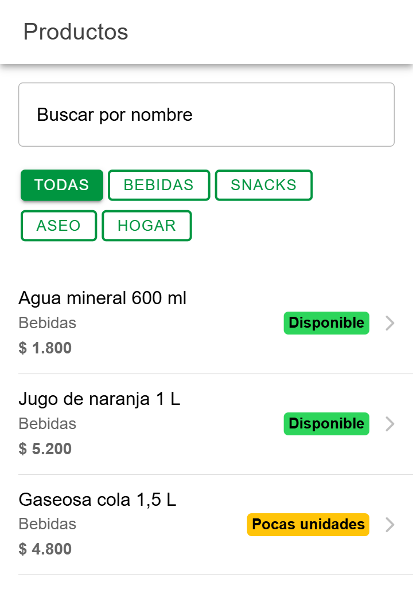
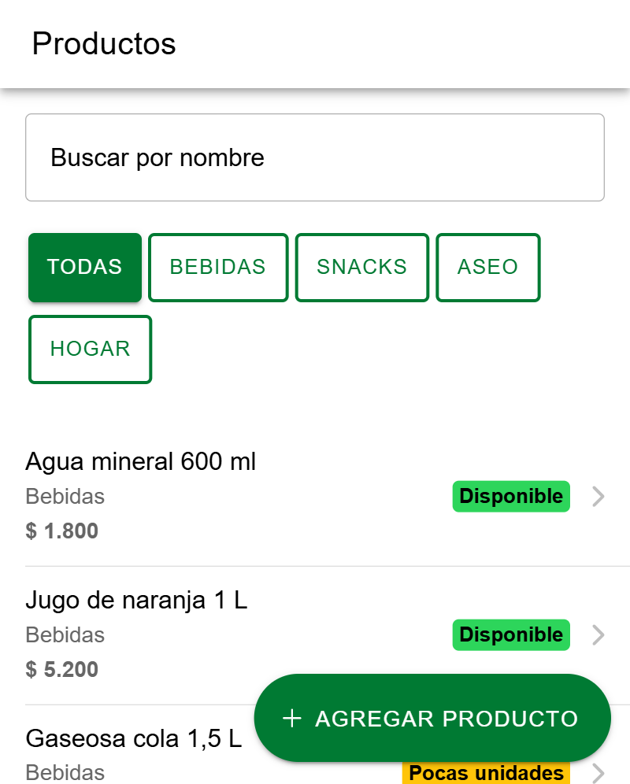
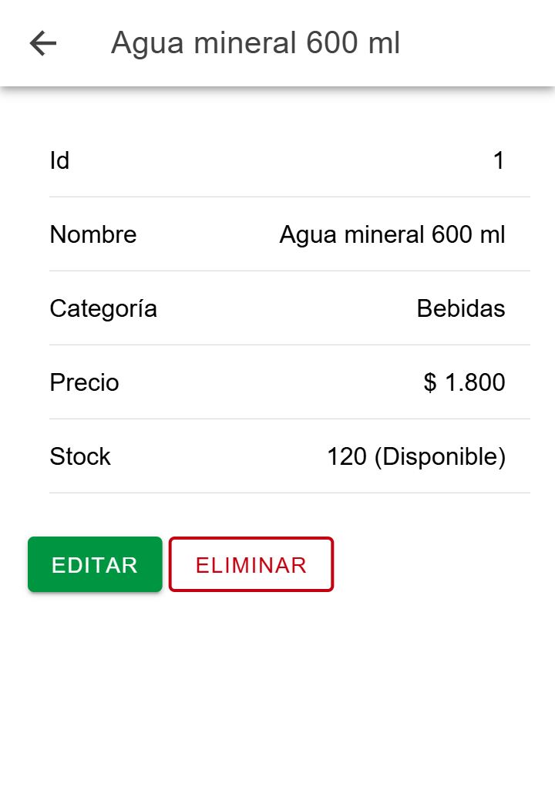
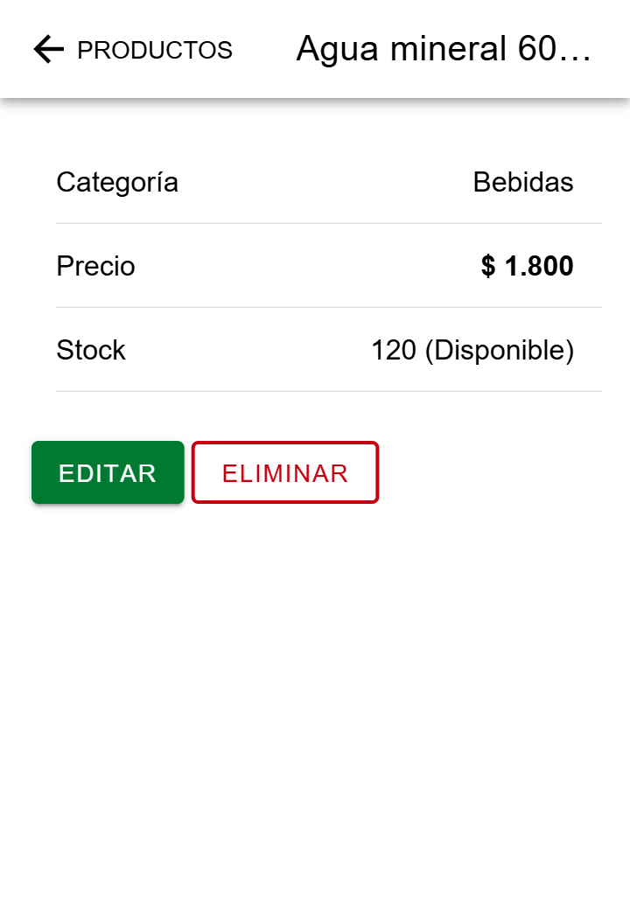
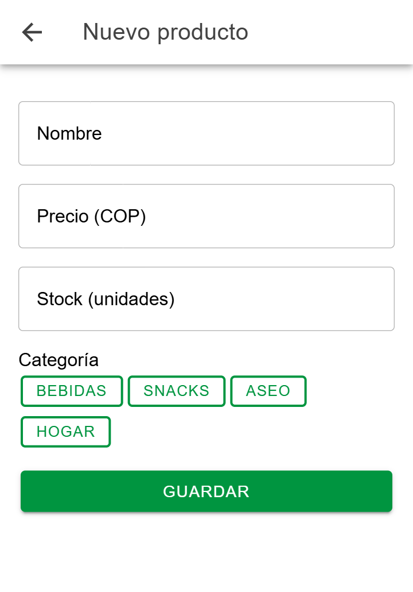
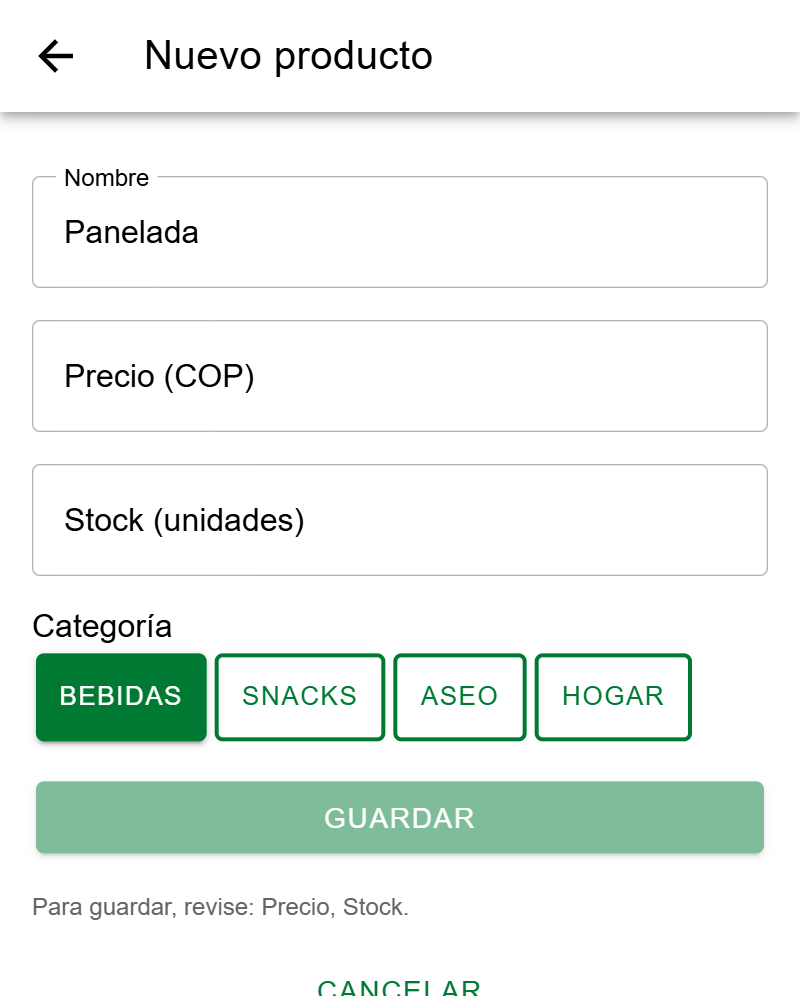
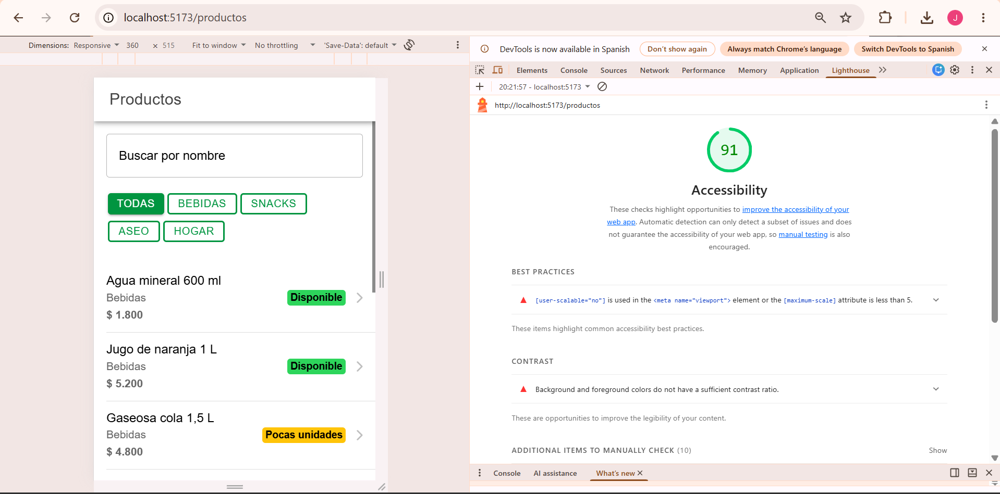
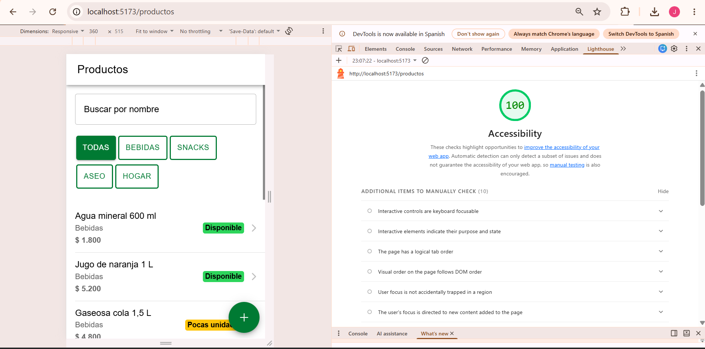

# CP9 · Antes y después, e historias para el equipo

## Lista de productos

| Antes | Después |
|---|---|
|  |  |

Cambió: el botón "Nuevo producto" pasó del final de la lista a un botón fijo "Agregar producto"; mientras carga se ve un skeleton; se puede recargar deslizando; los botones de categoría miden 44 px. Principios: jerarquía visual, estados de la interfaz y área táctil mínima.

## Detalle de producto

| Antes | Después |
|---|---|
|  |  |

Cambió: se quitó el Id, el precio va en negrita, el botón atrás dice "Productos" y eliminar pide confirmación con IonAlert y avisa con IonToast. Principios: jerarquía visual y retroalimentación.

## Formulario de producto

| Antes | Después |
|---|---|
|  |  |

Cambió: Guardar se deshabilita mientras hay errores y el aviso dice qué campo falta; aparece un spinner al enviar y un toast al guardar; Cancelar pide confirmación si hay datos escritos. Principios: prevención de errores y retroalimentación.

## Accesibilidad (Lighthouse, Mobile)

| Antes: 91 | Después: 100 |
|---|---|
|  |  |

Cambió: se permite el zoom, el verde primario pasó de 3.9:1 a 5.5:1 de contraste y los botones de categoría tienen `aria-pressed`. Principio: accesibilidad.

## Historias de usuario para el backlog de My-Academic-Space

### HU-W11-01 · Estados de carga, error y vacío en la lista de tareas

Como estudiante, quiero ver qué está pasando mientras se cargan mis tareas, para no pensar que la app se dañó.

Criterios de aceptación:
- Dado que la lista de tareas está cargando, cuando abro la pantalla, entonces veo filas skeleton con la forma de una tarea y no una pantalla en blanco.
- Dado que la API falla, cuando se intenta cargar la lista, entonces veo un mensaje de error y un botón Reintentar que vuelve a pedir las tareas.
- Dado que no tengo tareas registradas, cuando abro la pantalla, entonces veo "Aún no tienes tareas" y un botón para crear una.
- Existe una prueba automatizada que verifica el estado de error y el botón Reintentar.

### HU-W11-02 · Formulario de tarea con validación y confirmación

Como estudiante, quiero que el formulario de tarea me diga qué está mal antes de guardar, para no perder tiempo con registros incorrectos.

Criterios de aceptación:
- Dado que dejo un campo obligatorio vacío o con un valor inválido, cuando lo toco, entonces aparece el mensaje de error debajo de ese campo.
- Dado que hay campos con errores, entonces el botón Guardar está deshabilitado y un aviso nombra los campos pendientes.
- Dado que guardo una tarea válida, cuando la API responde bien, entonces veo un toast "Tarea guardada".
- Dado que escribí datos y toco Cancelar, entonces aparece una alerta "¿Descartar cambios?" antes de salir.

### HU-W11-03 · Tokens de diseño y accesibilidad básica

Como estudiante con baja visión, quiero poder ampliar la pantalla y leer bien los botones, para usar la app sin forzar la vista.

Criterios de aceptación:
- El viewport de `index.html` no tiene `user-scalable=no` ni `maximum-scale`.
- Los colores están definidos como tokens en `variables.css` y todo par de texto y fondo tiene contraste de al menos 4.5:1, verificado con WebAIM.
- Los botones e íconos tocables miden al menos 44 px de alto y los botones de solo ícono tienen `aria-label`.
- Lighthouse en Accesibilidad (Mobile) da 95 o más en las pantallas principales.