# Semana 14 · App con hardware y conectividad

App Ionic + Angular + Capacitor que:

- Usa el **GPS** (`@capacitor/geolocation`) con manejo de permisos.
- Hace **login por token (JWT)** contra mi API Task Manager (Spring Boot, proyecto fullstack) y consume la **ruta protegida** `GET /api/v1/tasks`.
- Maneja **401** (sesión vencida) y **sin red** (`@capacitor/network`).
- Muestra los tres estados de UX: **carga, datos y error**.
- Incluye pruebas unitarias con Vitest en `src/app/utils/http-error.spec.ts`.

## Cómo ejecutar

```bash
npm install
npm install @capacitor/geolocation @capacitor/network @capacitor/preferences
npx cap sync
ionic serve              # navegador
npx cap run android      # dispositivo / emulador
npm run test:unit        # pruebas unitarias (Vitest)
```

Configura la URL de la API en `src/environments/environment.ts` (navegador) y `environment.prod.ts` (Android).

### API usada

| Método | Ruta | Acceso | Uso en la app |
|---|---|---|---|
| POST | `/api/v1/auth/login` | Público | Pantalla de login, devuelve el JWT |
| GET | `/api/v1/tasks` | JWT | Lista de tareas (petición protegida) |

La API se ejecuta con `docker compose up --build` desde el proyecto fullstack. Su variable
`CORS_ALLOWED_ORIGINS` debe incluir `http://localhost:8100` (ionic serve) y `http://localhost` (Android).

## Estructura

| Archivo | Responsabilidad |
|---|---|
| `services/auth.service.ts` | Login, guarda el token en Preferences, logout |
| `interceptors/auth.interceptor.ts` | Agrega `Bearer`, bloquea peticiones sin red, maneja 401 y timeout |
| `services/network.service.ts` | Estado de la red en tiempo real |
| `services/location.service.ts` | Revisa y pide permisos, obtiene la posición GPS |
| `guards/auth.guard.ts` | Protege rutas que requieren sesión |
| `utils/http-error.ts` | Convierte errores técnicos en mensajes para el usuario |
| `pages/home` | Lista de tareas (petición protegida) con estados carga / datos / error |
| `pages/location` | Pantalla del GPS con estado de permiso negado |

## Evidencias

Capturas en `docs/evidencias/`.

| # | Qué demuestra | Captura |
|---|---|---|
| 0 | API Task Manager (Spring Boot + PostgreSQL) corriendo con Docker | 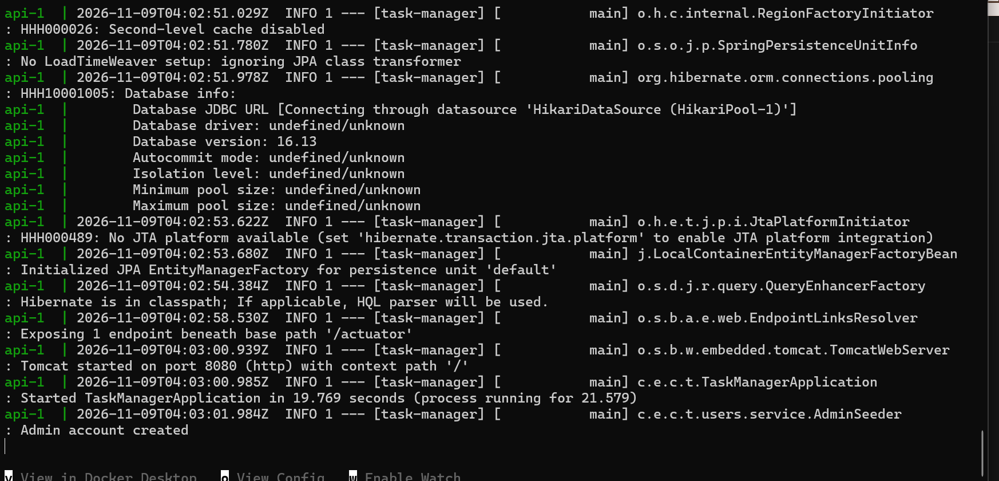 |
| 1 | Login con credenciales incorrectas: la API responde 401 y la app muestra el mensaje | 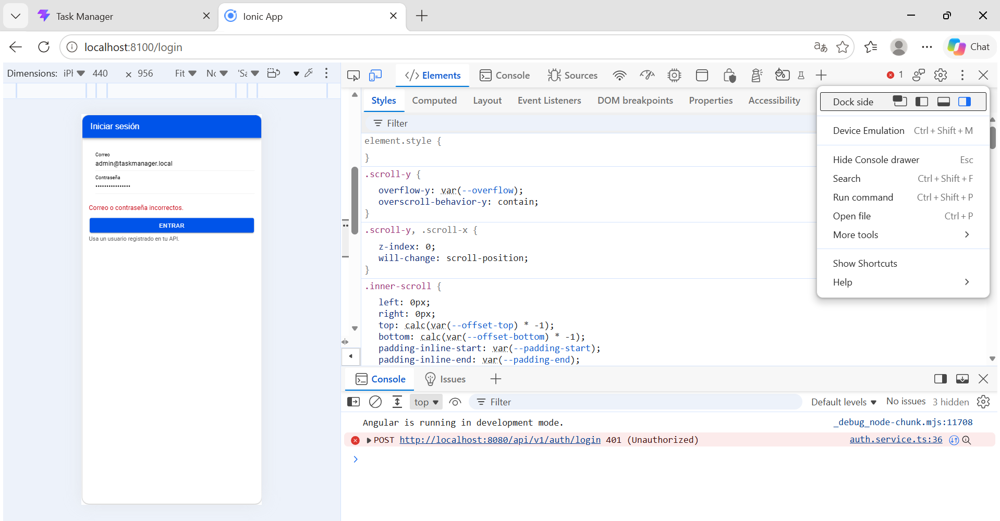 |
| 1b | Network: `login` 401 y preflight CORS 200 | 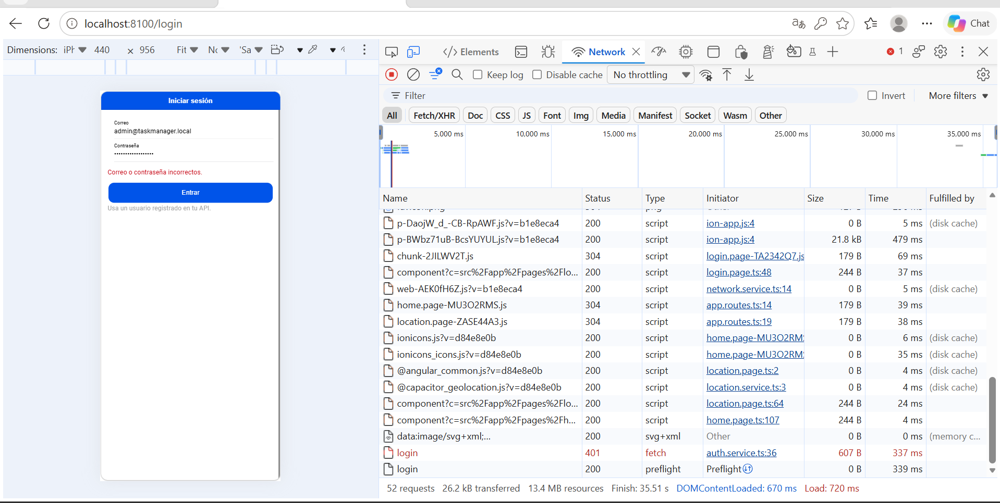 |
| 2 | Estado de carga (red 3G simulada) | 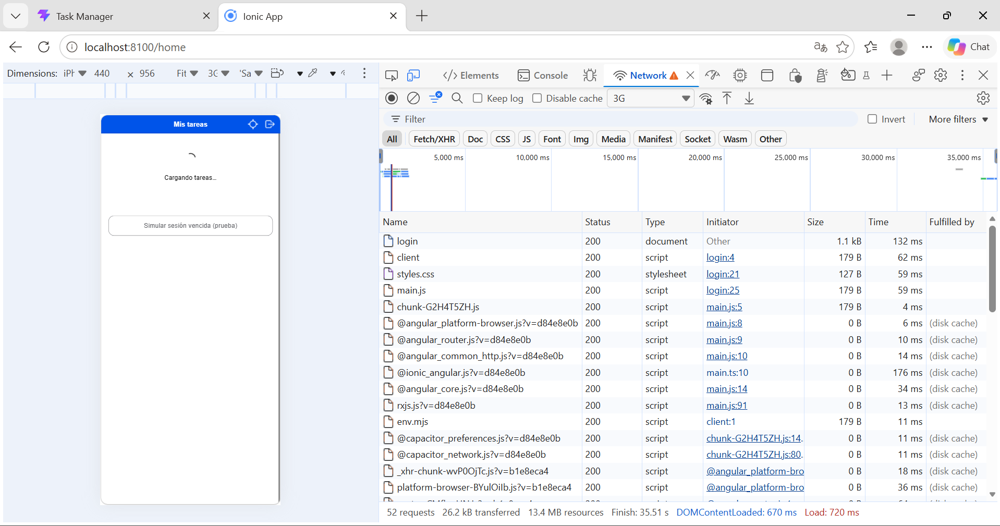 |
| 3 | Estado de datos: tareas desde la ruta protegida `GET /api/v1/tasks` | 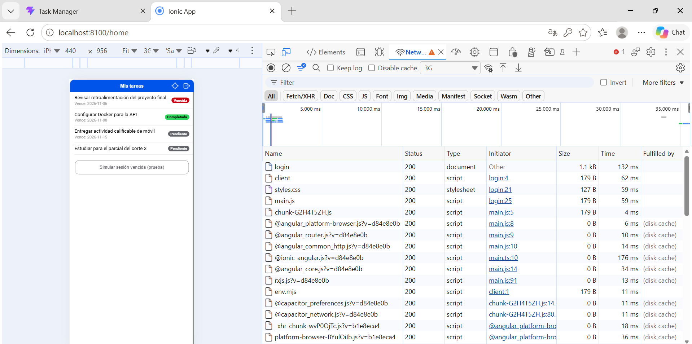 |
| 4 | Header `Authorization: Bearer` enviado por el interceptor | 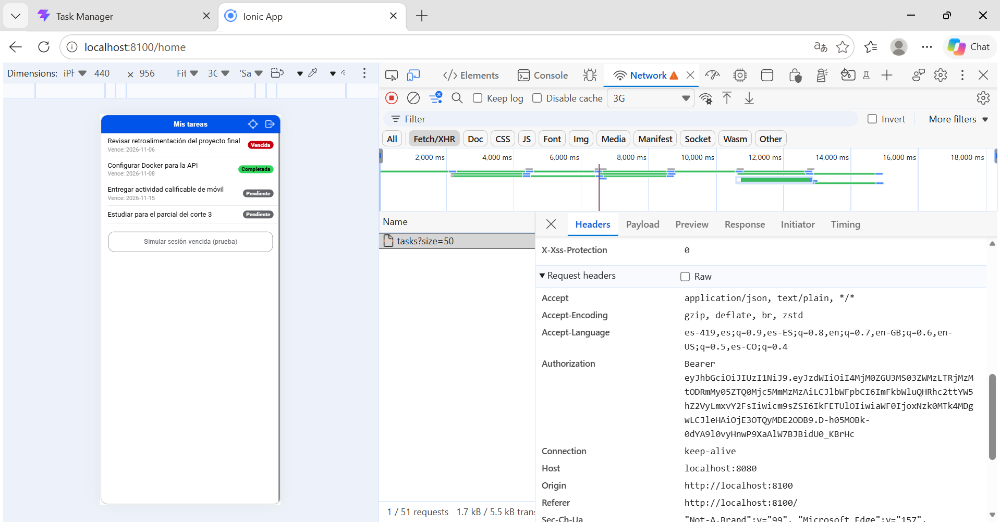 |
| 5 | Sin red: estado de error con botón Reintentar | 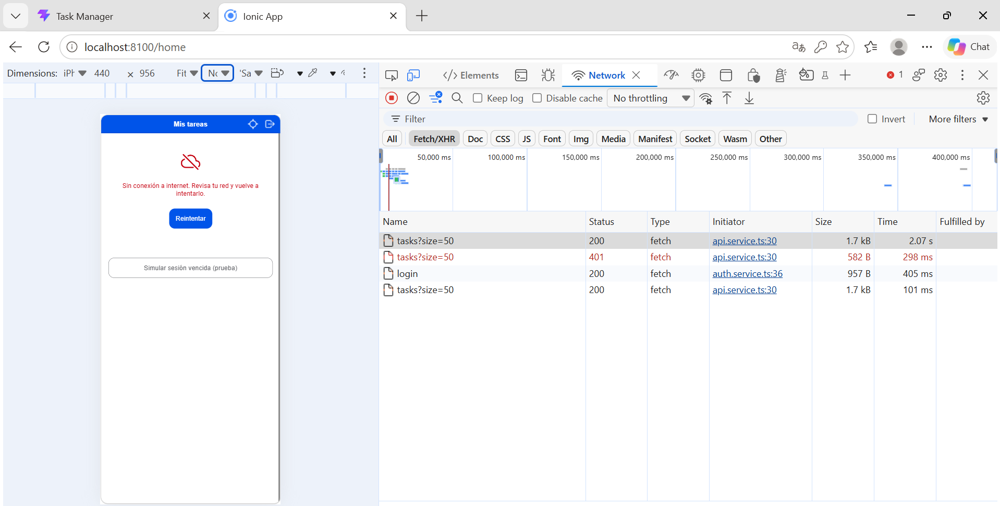 |
| 5b | Sin red: banner "Sin conexión a internet" | 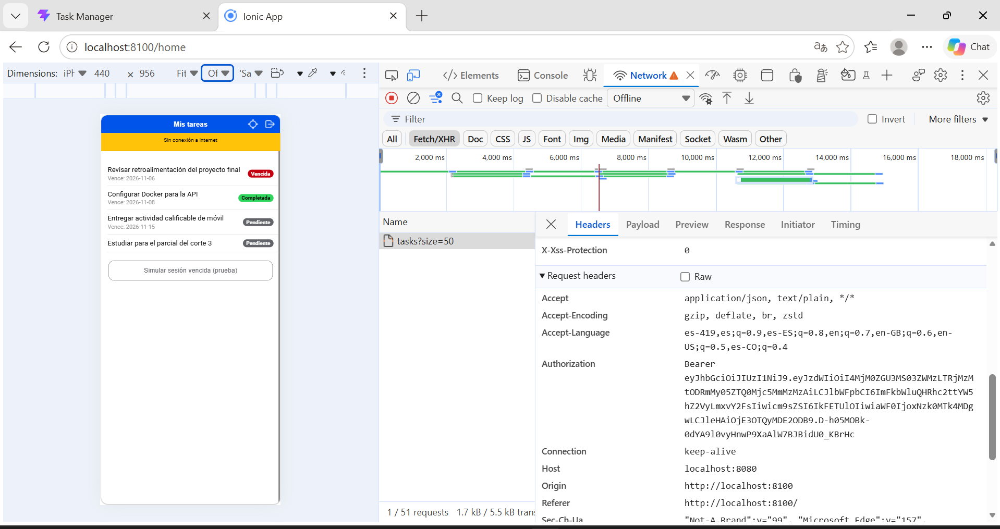 |
| 6 | 401 en ruta protegida: cierra sesión, vuelve al login y avisa "Tu sesión expiró" | 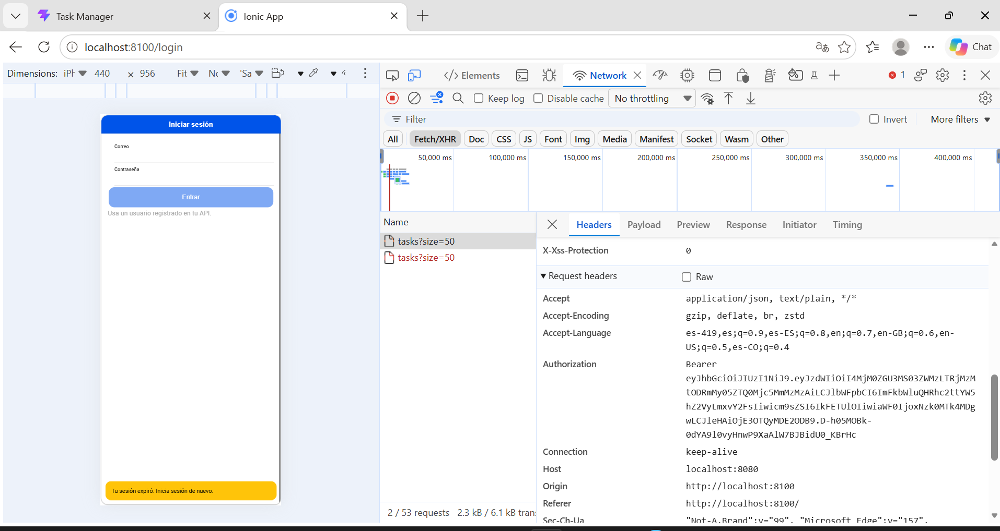 |
| 7a | Pantalla de ubicación: el GPS solo se usa cuando el usuario lo pide | 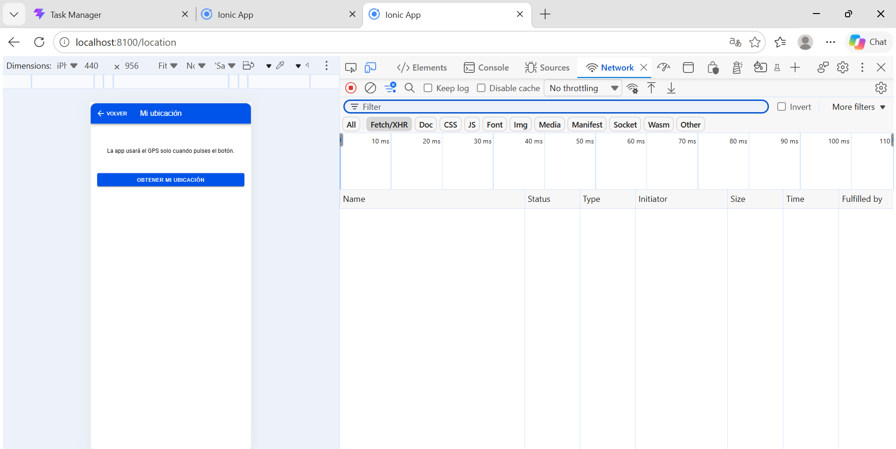 |
| 7 | Solicitud de permiso de ubicación | 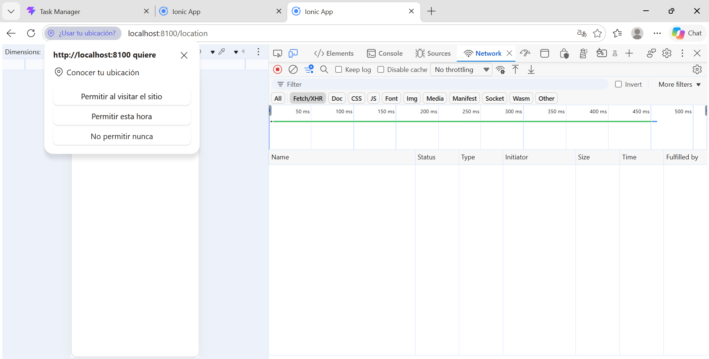 |
| 8 | Permiso de ubicación rechazado: la app informa sin romperse | 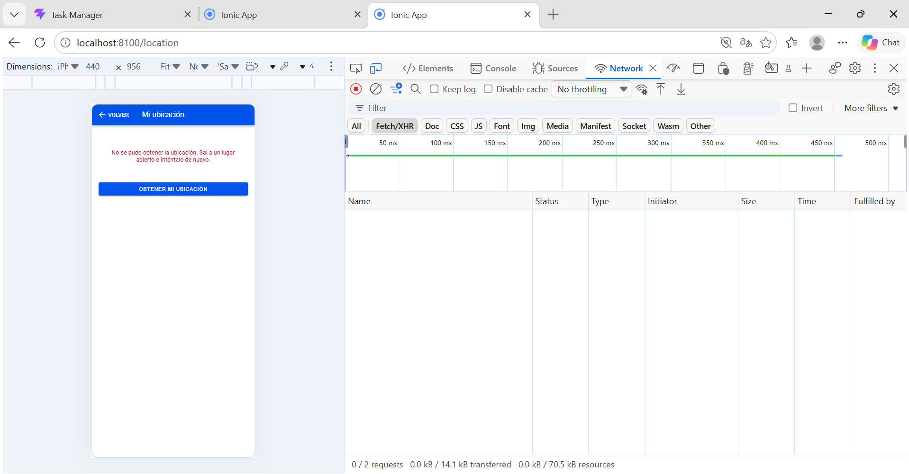 |
| 9 | Ubicación obtenida (GPS) |  |
| 10 | Pruebas unitarias en verde (Vitest, 7/7) | 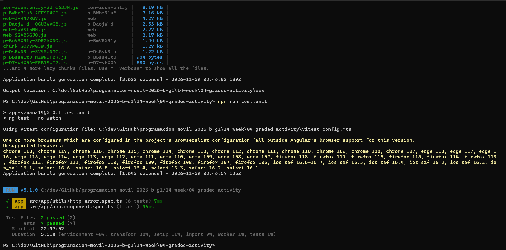 |

## Quality & connectivity

The app asks for location permission only when the user taps "Get my location", instead of at startup, so the request has clear context. Before reading the GPS, `LocationService` calls `checkPermissions()`, and it calls `requestPermissions()` only if the permission is still undecided; if the user denies it, the screen explains how to enable it in the system settings instead of failing silently. After a successful login, the API token is stored with Capacitor Preferences, and an HTTP interceptor adds it to every protected request as an `Authorization: Bearer` header. When the API answers with a 401 status, the interceptor treats the token as expired or invalid: it deletes the token, redirects the user to the login screen and shows a short message, while a 401 on the login request itself is shown as "wrong credentials". Connectivity is monitored with the Capacitor Network plugin, so requests are blocked while the device is offline, an offline banner is displayed, and every request has a 15-second timeout. All technical errors (offline, timeout, 401, 4xx and 5xx) are translated into clear user messages by the pure function `toAppError`, which is covered by unit tests. Finally, every data screen has three explicit states (loading, data and error) and the error state always offers a "Retry" button, so the user is never left on a blank screen.
