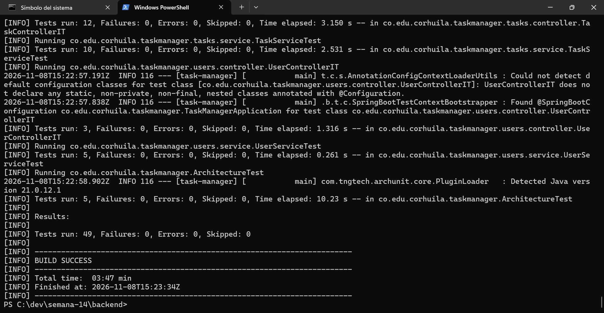
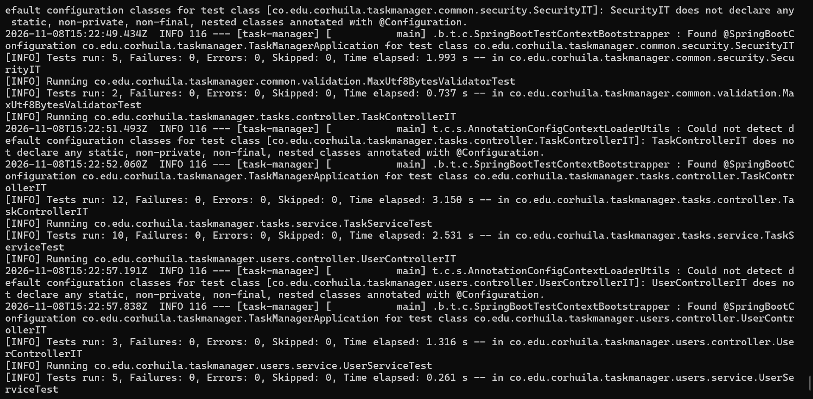
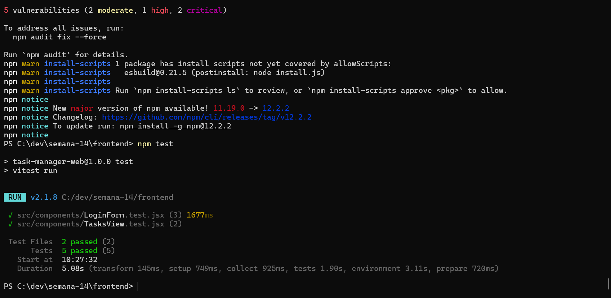
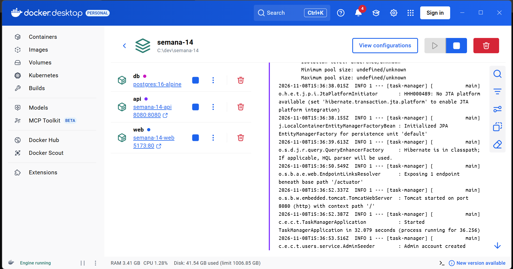
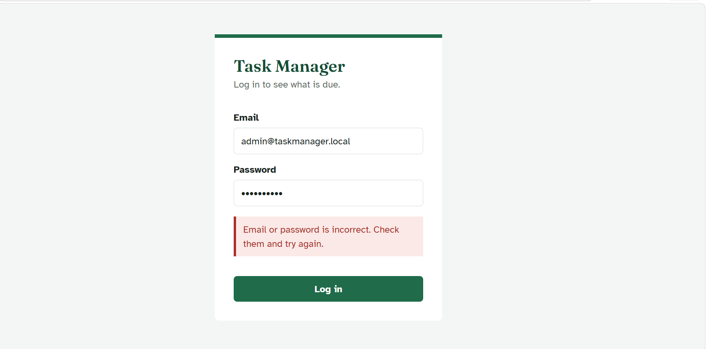
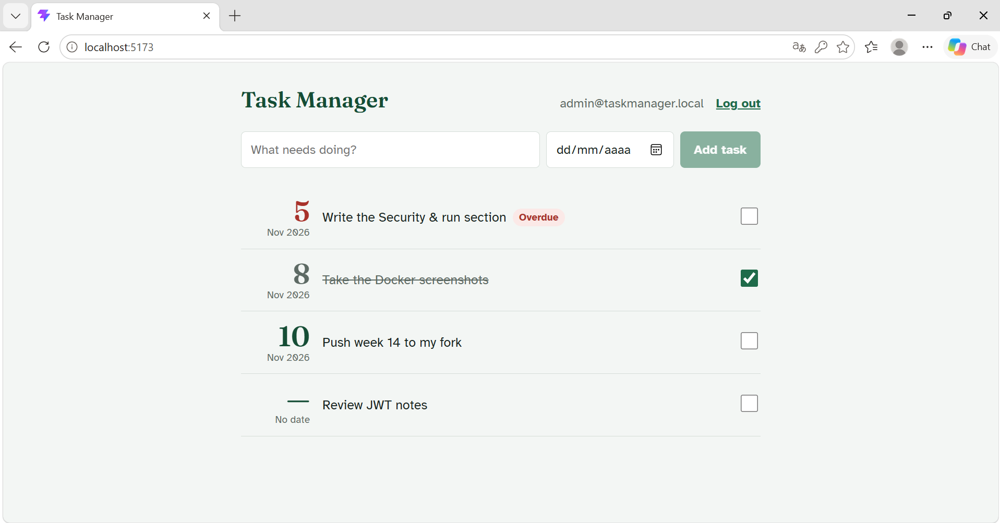
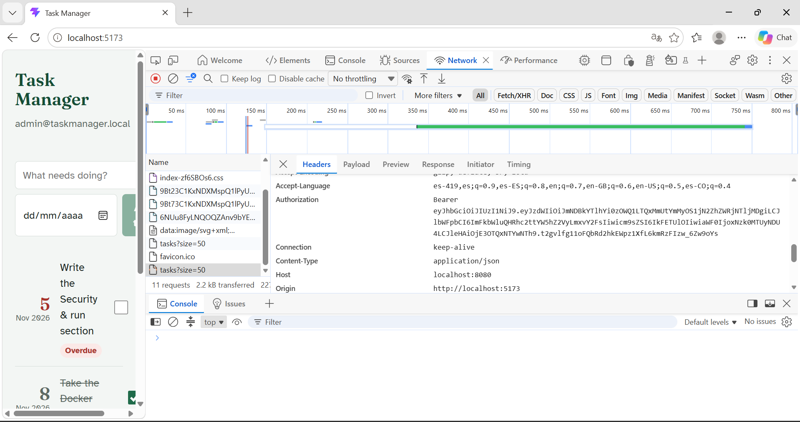
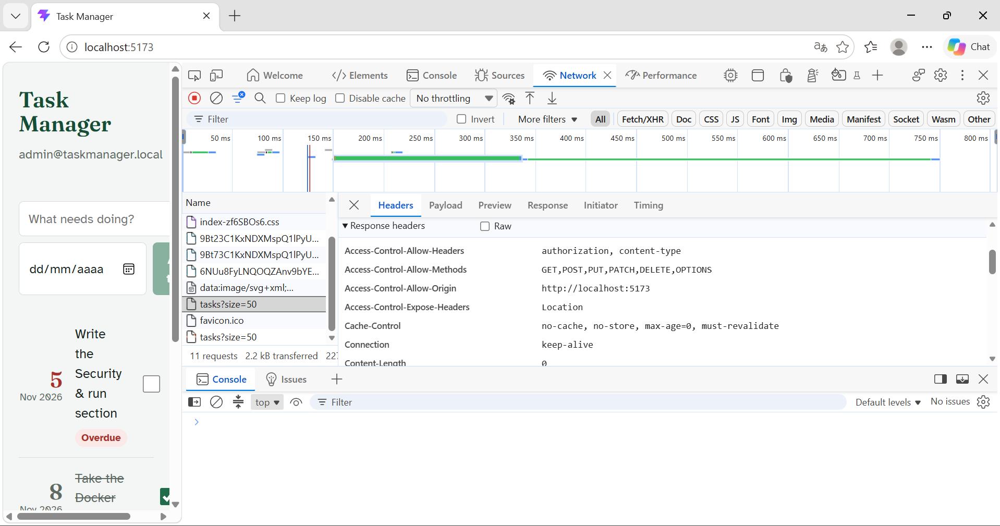

# Semana 14 · Corte 3 — App fullstack segura y probada

Task Manager: API REST en **Spring Boot 3 (Java 21)** con seguridad JWT, frontend en **React + Vite**
que la consume, pruebas en ambos lados y ejecución completa con **Docker Compose**.

## Estructura

```
semana-14/
├── backend/             API Spring Boot (tm-fs-api) + Dockerfile
│   └── src/test/.../common/security/SecurityIT.java   ← pruebas JWT + CORS de esta semana
├── frontend/            SPA React (login + vista de tareas) + Dockerfile
│   └── src/components/*.test.jsx                      ← pruebas de frontend
├── docker-compose.yml   PostgreSQL + API + SPA
├── docs/                Capturas de evidencia
└── README.md
```

## Endpoints usados

| Método | Ruta                          | Acceso    | Uso en el frontend          |
|--------|-------------------------------|-----------|-----------------------------|
| POST   | `/api/v1/auth/login`          | Público   | Pantalla de login           |
| GET    | `/api/v1/tasks`               | JWT       | Lista de tareas             |
| POST   | `/api/v1/tasks`               | JWT       | Agregar tarea               |
| PATCH  | `/api/v1/tasks/{id}/status`   | JWT       | Marcar completada/pendiente |

Usuario de prueba creado al arrancar: `admin@taskmanager.local` / `Admin12345`.
También puedes crear uno con `POST /api/v1/auth/register` desde Swagger (`http://localhost:8080/swagger-ui.html`).

## Security & run

**Auth flow (JWT).** The user logs in from the React app, which sends the email and password to
`POST /api/v1/auth/login`. The API checks the password against its BCrypt hash and, if it matches,
returns a JWT signed with HS256 that carries the user id, email and role and expires after 60 minutes.
The frontend keeps the token in `sessionStorage` and sends it in the `Authorization: Bearer <token>`
header on every request to protected endpoints such as `GET /api/v1/tasks`. A Spring Security filter
validates the signature and expiration of the token; if it is missing, forged or expired, the API
answers `401 Unauthorized` and the frontend sends the user back to the login screen. Because the SPA
(`http://localhost:5173`) and the API (`http://localhost:8080`) run on different origins, the API has
a CORS policy that only allows the origins listed in `CORS_ALLOWED_ORIGINS`.

**Tests.** The backend uses JUnit 5 and MockMvc: `SecurityIT` checks that a valid token opens a
protected endpoint, that a forged or expired token returns 401, and that a CORS preflight from an
unknown origin is rejected with 403, while `AuthControllerIT` covers a successful login and a login
with a wrong password. The frontend uses Vitest and Testing Library: `LoginForm.test.jsx` checks the
successful login and the error message shown on a 401 response, and `TasksView.test.jsx` checks that
the token is sent as a Bearer header and that a 401 ends the session.

**Run with Docker.** With Docker Desktop running, execute `docker compose up --build` in this folder;
it starts PostgreSQL, builds and runs the API on port 8080, and serves the React app with nginx on
port 5173. Open `http://localhost:5173` and log in with `admin@taskmanager.local` / `Admin12345`.
Stop everything with `docker compose down` (add `-v` to delete the database volume).

### Comandos

```bash
# Toda la app en contenedores
docker compose up --build
# → http://localhost:5173 (frontend)   http://localhost:8080/swagger-ui.html (API)

# Pruebas de backend (sin instalar Java ni Maven: corren dentro de un contenedor)
cd backend
docker run --rm -v "${PWD}:/app" -w /app maven:3.9-eclipse-temurin-21 mvn -B test
# Con Maven local: mvn test

# Pruebas de frontend
cd ../frontend
npm install
npm test

# Desarrollo local del frontend (la API debe estar corriendo en :8080)
npm run dev
```

## Evidencias

### Pruebas
Backend: 49 pruebas en verde, incluidas las 5 de `SecurityIT` (JWT + CORS).




Frontend: 5 pruebas en verde (Vitest).



### Docker
Los 3 contenedores (db, api, web) corriendo con `docker compose up --build`.



### Login (caso de error) y vista con datos



### JWT y CORS de extremo a extremo
Petición real con el token en el header `Authorization`:



Respuesta del preflight CORS autorizando el origen del frontend:



## Autor

- Nombre: Julio Cesar Lozano Lozano
- GitHub: Lozano-027
